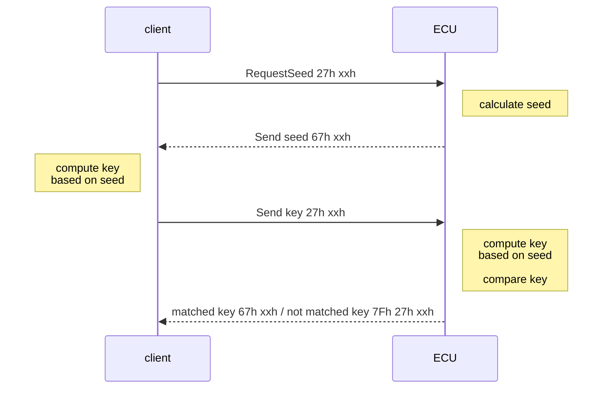

# 通用诊断规范:诊断安全防护机制
**General Diagnostic Specification: Diagnostic Security Protection**

**分类号 (Classification):** Q/FVW
**一汽-大众汽车有限公司企业标准 (FAW-VOLKSWAGEN Enterprise Standard):** Q/FVW XXXX-2025
**机密级别:** 普通商密 / Confidential
**状态:** 标准废止前 / Before the abolition of the standard

> 禁止未经脱密,未经审核,扩大知悉范围
> Forbidden to expand the awareness scope of information without declassification and review.

## 修订记录 (Revision History)

| 修订次 (Revision) | 日期 (Date) | 简单描述变化点 (Description of Changes) | 起草人 (Drafter) | 审核(L2) (Reviewer) | 批准(高级经理) (Approval) |
| :--- | :--- | :--- | :--- | :--- | :--- |
| 首次采用 (First adoption) | 2025 | 制定 | | | |

**一汽-大众汽车有限公司 发布**
**Published by FAW-VOLKSWAGEN**

---

## 目次 (Table of Contents)

*   [前言 (Foreword)](#前言-foreword)
*   [1 范围 (Scope)](#1-范围-scope)
*   [2 规范性引用文件 (Normative reference documents)](#2-规范性引用文件-normative-reference-documents)
*   [3 术语和定义 (Terms and Definition)](#3-术语和定义-terms-and-definition)
*   [4 离线诊断安全访问机制描述 (Offline diagnostic secure access system description)](#4-离线诊断安全访问机制描述-offline-diagnostic-secure-access-system-description)
    *   [4.1 离线安全访问等级定义 (Offline security access level definition)](#41-离线安全访问等级定义-offline-security-access-level-definition)
    *   [4.2 安全访问算法 (Security Access Algorithm)](#42-安全访问算法-security-access-algorithm)
        *   [4.2.1 参数描述 (Parameter description)](#421-参数描述-parameter-description)
        *   [4.2.2 密钥生成 (Key Generation)](#422-密钥生成-key-generation)
        *   [4.2.3 Application 下的安全访问 (Security Access in application)](#423-application-下的安全访问-security-access-in-application)
        *   [4.2.4 Bootloader 下的安全访问 (Security Access in bootloader)](#424-bootloader-下的安全访问-security-access-in-bootloader)

---

## 前言 (Foreword)

本文是基于FAWVW EEA平台开发的诊断安全访问需求规范,定义了此平台的通用电子系统需遵循的安全访问实施规则。
This is the enhanced diagnostic requirement specification of FAWVW EEA platform and describes the implementation rules of secure access for the generic electronic system to be installed.

本文为一汽大众诊断规范的补充文件,制定诊断服务所需要的seed转key的算法及其使用规范。本文件定义的算法用作 $27_{hex}$ 服务中的安全密钥。
This specification is a supplementary document to FAWVW diagnostic specifications, formulating the seed to key algorithm required for diagnostic services and its usage specifications. The algorithm defined in this document is used as a security key in $27_{hex}$ service.

*   本标准由技术开发 产品数据管理科归口。
*   本标准起草部门: XXXXXXXXXXXXXXXX.
*   本标准主要起草人: XXX XXX.
*   本标准由技术开发 XXXXXXXXXXXXXXXX负责解释。
*   本标准涉及的其它专业部门/科室:(以便在意见征集时更加有针对性。起草人必须识别清楚所涉及的科室,如果有但未识别出,则相关科室有权不实施此标准)
*   本标准的历次版本发布情况为:(没有以前版本,可不写)
*   与以往版本相比,本版标准主要的变化点。(没有以前版本,可不写)

---

## 1 范围 (Scope)

本文件规定的安全级别Level 1和安全级别Level 2的算法,适用于所有可以进行安全访问的控制器节点。
The document defines the algorithms of Security access level 1 and Security access level 2, which are applicable to access ECU through secure access protection mechanism.

## 2 规范性引用文件 (Normative reference documents)

下列文件对于本文件的应用是必不可少的。凡是注日期的引用文件,仅所注日期的版本适用于本文件。凡是不注日期的引用文件,其最新版本(包括所有的修改单)适用于本文件。
The following documents are essential for the application of this document. For dated referenced documents, only the dated version applies to this document. For undated referenced documents, the latest version (including all amendments) applies to this document.

*   [Ref. 1] ISO 14229-1:2013, "Road vehicles — Unified diagnostic services (UDS) — Part 1: Specification and requirements," 2013.

## 3 术语和定义 (Terms and Definition)

下列术语和定义适用于本文件。
Following terms and definition apply to this document:

诊断服务(UDS)规范使用术语“安全访问”来命名授权机制。因此,在汽车领域,术语“安全访问”通常用于指诊断协议的授权机制。
在本文档中,术语“安全访问”用于表示一般用于限制对外部软件接口的访问的授权机制。

The Unified Diagnostic Services (UDS) specification employs the term Security Access to denominate the authorization mechanism. Consequently, in the automotive sector, the term Security Access is usually used to refer to authorization mechanisms for diagnostic protocols.
In this document, the term Secure Access is used to denominate the authorization mechanism used to restrict access to external software interfaces in general.

## 4 离线诊断安全访问机制描述 (Offline diagnostic secure access system description)

当诊断设备处于离线状态需进行APP, bootloader刷写时,需通过离线安全访问服务来获取对诊断客户端的访问权限。
When the diagnostic device need to flash the APP and Bootloader offline, it shall get the access to the client via offline secure access service.

该服务提供了一种访问数据和/或诊断服务的方法,由于安全、排放或安全原因,这些服务的访问受到限制,用于下载/上传例程或数据写至ECU,从ECU中读取特殊位置内存数据等诊断服务可能需要执行安全访问的情况。因为下载到ECU的不当的例程或数据可能破坏电子设备或其它汽车部件,或危及汽车的排放、安全性及安全标准的合规性。
This service provides a means to access data and/or diagnostic services, which have restricted access for security, emissions, or safety reasons. Diagnostic services for downloading/uploading routines or data into an ECU and reading specific memory locations from an ECU are situations where security access may be required. Improper routines or data downloaded into an ECU could potentially damage the electronics or other vehicle components or risk the vehicle's compliance to emission, safety, or security standards.

**图1 安全访问时序 (Figure 1: Sequence of security access)**

安全访问服务依靠所谓的“种子-密钥”机制。首先客户端(诊断仪或OTA master)发送 `0x27` 服务 "request Seed”消息来请求ECU“解锁”。ECU使用 `0x27` 服务正响应发送“种子”。该种子作为客户端生成“密钥”的输入参数。
The security access service is implemented by using a so-called "seed-key" mechanism. The client (tester or OTA master) shall firstly request the ECU to "unlock" by sending the `0x27` service 'requestSeed' message. The ECU shall respond by sending a "seed" using the `0x27` service 'requestSeed' positive response message. This "seed" is the input parameter for client to generate the "key".

然后客户端应使用 `0x27` 服务的发送密钥请求消息返回一个“密钥”的数值给ECU。ECU应将该”密钥“和内部存储/计算的”密钥“进行对比。如果二者数值匹配,则ECU将通过给出 `0x27` 服务正响应信息“解锁”客户端对某些服务/数据的访问。
The client shall then respond by returning a "key" number back to the ECU using the `0x27` service 'sendKey' request message. The ECU shall compare this "key" to one internally stored/calculated. If the two numbers match, then the ECU shall enable ("unlock") the client's access to specific services/data and indicate that with the service `0x27` 'sendKey' positive response message. If the two numbers do not match, this shall be considered a false access attempt.

无效的密钥将需要客户端从 `0x27` “requestSeed”消息重新开始。
An invalid key shall require the client to start over from the beginning with a `0x27` 'requestSeed' message.

### 4.1 离线安全访问等级定义 (Offline security access level definition)

ECU应支持多个安全等级,且同一时间应仅有1个安全等级被激活。安全等级数值是任意分配的,各安全等级之间没有关联。
The ECU shall support multiple security levels, and only one security level shall be active at any instant of time. The security levels numbering is arbitrary and does not imply any relationship between the levels.

“请求种子”子功能参数值应总是奇数,其对应的同一安全级别下的“发送密钥”子功能参数值应在“请求种子”子功能参数值基础上加1。
The "request Seed" SubFunction parameter value shall always be an odd number and the corresponding "sendKey" SubFunction parameter value for the same security level shall equal the "request Seed" SubFunction parameter value plus one.

安全访问等级1可能被用来解锁应用程序诊断模式扩展会话下的某些服务,例如通过标识符写入数据(`0x2E`)服务。
Security access level 1 may be used to unlock specific UDS services of extended diagnostic session in application software diagnostic session, such as WriteDataByIdentifier (`0x2E`) service.

安全访问等级2可能被用来解锁引导程序诊断模式下的某些服务,例如编程会话下请求下载(`0x34`)服务、传输数据(`0x36`)服务以及请求传输退出(`0x37`)服务。
Security access level 2 may be used to unlock specific UDS services of boot software diagnostic session, e.g., to transmit data between the client and ECU memory in programming session, such as Request Download (`0x34`) service, Transfer Data (`0x36`) service and Request TransferExit (`0x37`) service.

**表1 安全访问服务子功能定义 (Table 1: Subfunction definition of security access service)**

| Subfunction value (hex) 子功能参数值(hex) | Description 描述 | Cvt 约束 |
| :--- | :--- | :--- |
| `03` | Security access level 1: securityAccessType request Seed | M |
| `04` | Security access level 1: securityAccessType sendKey | M |
| `11` | Security access level 2: securityAccessType request Seed | C* |
| `12` | Security access level 2: securityAccessType sendKey | C* |

> **Note:**
> M: Mandatory 强制
> C*: Conditional - reprogramming ECUs shall support this security access level (取决于使用条件,重编程ECU应支持该安全访问等级)

### 4.2 安全访问算法 (Security Access Algorithm)

#### 4.2.1 参数描述 (Parameter description)

*   `Seed[11]`: 种子数组, 12字节。the seed array, 12 Bytes.
*   `Key[11]`: 计算的密钥数组, 12字节。the calculated key array, 12 Bytes.
*   `Mask[3]`: 掩码数组, 4字节。Mask array, 4 Bytes.
*   `AESKey1[15]`: 预先共享的AES密钥, 此密钥为固定值, 用于安全访问等级1, 16字节, $AESKey1 = \text{71f9ak515e8d4g3h}$ (string). Fixed pre-shared AES secret key for security access level 1, 16 bytes.
*   `AESKey2[15]`: 预先共享的AES密钥, 此密钥为固定值, 用于安全访问等级2, 16字节, $AESKey2 = \text{86ae5j1ks0fgk2c9}$ (string). Fixed pre-shared AES secret key for security access level 2, 16 bytes.
*   `IV[15]`: 初始向量, 16字节, 此向量为固定值, $IV = \text{60f5b79md4se6g8h}$ (string), 安全等级1和安全等级2的初始向量值相同。Fixed initial vector, 16 bytes, the value is same for security access level 1 and security access level 2.

*注意: 数组元素编号从0开始。 (Note: the index of array item starts from 0.)*

每次当ECU收到“requestSeed”报文时,ECU应生成1个12字节的真随机种子,例如从HSM的随机数发生器生成随机数。种子值不能为 `0xFFFFFFFFFFFFFFFFFFFFFFFF` 或 `0x000000000000000000000000`。
Each time the ECU receives a "request Seed" message, The ECU shall generate a 12-byte true random seed, e.g., random seed is generated from a random number generator of HSM, and the seed value shall not be `0xFFFFFFFFFFFFFFFFFFFFFFFF` or `0x000000000000000000000000`.

仅当ECU被请求的安全等级已解锁且收到“requestSeed”报文时,ECU应给出种子为0的肯定响应。
Only when the requested security level is already unlocked and a "request Seed" message is received, The ECU shall send a positive response message with a seed value equal to zero (0).

掩码值应由OEM决定和管理并分配给ECU供应商,此规范给出的掩码值作为例子仅供参考。
The mask shall be decided and managed by OEM and assigned to ECU suppliers. The Mask value in this specification are examples just for reference.

#### 4.2.2 密钥生成 (Key Generation)

算法的输入应该是ECU特定的掩码(4字节)与随机种子(12字节)的连接。
The input to the algorithm shall be the ECU-specific mask (4 bytes) concatenated with the random seed (12 bytes).

ECU和客户端使用AES128算法(CBC模式,无填充)和预先共享的AES密钥(16字节)及初始向量IV生成一个16字节的输出。
The ECU and client shall use the AES128 algorithm (CBC mode, no padding) with the pre-shared AES secret key and initial vector (IV) to generate a 16 bytes output.

然后ECU和客户端从输出的16字节中提取12字节按照一定的顺序排列作为密钥。
The ECU and the client then extract 12 bytes from the 16 bytes of the output, and put them in a certain order as the key.

#### 4.2.3 Application 下的安全访问 (Security Access in application)

**对于安全访问等级1 (For security access level 1):**

*   $AESKey1 = \text{71f9ak515e8d4g3h}$ (string)
*   $IV = \text{60f5b79md4se6g8h}$ (string)
*   $Key1[11] = \{Output[7], Output[2], Output[15], Output[5], Output[9], Output[0], Output[1], Output[6], Output[11], Output[4], Output[14], Output[8]\}$

**图1: 安全访问等级1的密钥生成流程 (Key generation flow of security access level 1)**
*(Logic representation based on diagram)*
1.  **Input Generation:** `Seed[11]` (12 Bytes, MSB) + `Mask[3]` (4 Bytes, LSB) = `Input` (16 Bytes).
2.  **AES128 Process:** Apply `AES128 Algorithm (CBC mode)` using `Input (16 Bytes)`, `IV (16 Bytes)`, and `AESKey1 (16 Bytes)`.
3.  **Output:** Generates `Output[15]` (16 Bytes).
4.  **Key Extraction:** Rearrange bytes from Output to generate `Key1[11]` as defined in the formula above.

**举例如下 (For example):**

*   $Mask = \text{691b3f23 (hex)}$
*   $Seed = \text{853767c8aad4e2e072e4e241 (hex)}$
*   $Input (Seed, Mask) = \text{853767c8aad4e2e072e4e241691b3f23 (hex)}$

安全等级1 (Security level 1):
*   $AESKey1 = \text{71f9ak515e8d4g3h (string)}$
*   $IV = \text{60f5b79md4se6g8h (string)}$
*   $Output = \text{AES128}(\text{853767c8aad4e2e072e4e241691b3f23}) = \text{9f32e5c752d6b6c4d1014541d823ab41 (hex)}$
*   $Key1 = \text{c4e541d6019f32b64152abd1 (hex)}$

#### 4.2.4 Bootloader 下的安全访问 (Security Access in bootloader)

**对于安全访问等级2 (For security access level 2):**

*   $AESKey2 = \text{86ae5j1ks0fgk2c9}$ (string)
*   $IV = \text{60f5b79md4se6g8h}$ (string)
*   $Key2[11] = \{Output[3], Output[11], Output[0], Output[1], Output[6], Output[9], Output[4], Output[15], Output[12], Output[14], Output[5], Output[7]\}$

**图2: 安全访问等级2的密钥生成流程 (Key generation flow of security access level 2)**
*(Logic representation based on diagram)*
1.  **Input Generation:** `Seed[11]` (12 Bytes, MSB) + `Mask[3]` (4 Bytes, LSB) = `Input` (16 Bytes).
2.  **AES128 Process:** Apply `AES Algorithm (CBC mode)` using `Input (16 Bytes)`, `IV (16 Bytes)`, and `AESKey2 (16 Bytes)`.
3.  **Output:** Generates `Output[15]` (16 Bytes).
4.  **Key Extraction:** Rearrange bytes from Output to generate `Key2[11]` as defined in the formula above.

**举例如下 (For example):**

*   $Mask = \text{9518d8c4 (hex)}$
*   $Seed = \text{22cb01d0b176e3955d65a202 (hex)}$
*   $Input (Seed, Mask) = \text{22cb01d0b176e3955d65a2029518d8c4 (hex)}$

安全等级2 (Security level 2):
*   $AESKey2 = \text{86ae5j1ks0fgk2c9 (string)}$
*   $IV = \text{60f5b79md4se6g8h (string)}$
*   $Output = \text{AES128}(\text{22cb01d0b176e3955d65a2029518d8c4}) = \text{cbf89e265fbb40dd031e1254af2f897f (hex)}$
*   $Key2 = \text{2654cbf8401e5f7faf89bbdd (hex)}$